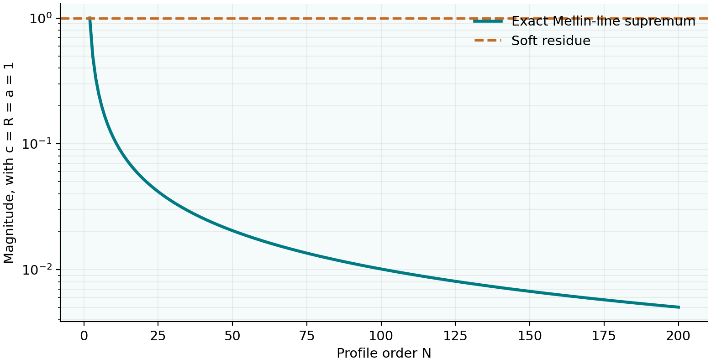

# Celestial Infrared Stability

**Exact limits and optimal recovery of soft data in celestial Mellin space.**

Deep Bhattacharjee · James Montgomery Lockwood · Tristan Romanov · Ikailo John Sessford · Ushashi Bhattacharya · Sanjeevan Singha Roy

Working research draft with one unranked prospective author list supplied by the project lead. Coauthor review and approval remain pending.

[Read the paper](paper/manuscript.pdf) · [Reproduce the calculations](#reproduce) · [Sources and originality review](RELATED-WORK.md)

## The central result

A soft residue can stay fixed while the entire Mellin transform on a vertical line becomes uniformly arbitrarily small. This occurs even for positive profiles with the same complex analyticity radius.

For fixed $R>0$, $c>0$, and $a>0$, take

$$A_N(\omega)=c\,\omega^{-p}(1+\omega/R)^{-N},\qquad N>a.$$

Then

$$\operatorname{Res}_{s=p}\widetilde A_N(s)=c,\qquad
\sup_{\nu\in\mathbb R}|\widetilde A_N(p+a+i\nu)|
=cR^a B(a,N-a)\longrightarrow0.$$

The proof is explicit. The stripped profile is completely monotone, its nearest complex singularity stays at $-R$, and its derivative at zero grows like $N/R$. A uniform derivative or complex-norm bound would supply an additional restriction.

For a constant subleading soft term, choose $p=0$, $a=1$. The data line is then the usual four-dimensional principal series. For a leading $\omega^{-1}$ term, the theorem concerns a displaced line to the right of its pole. The boundary contour through the leading pole requires a separate distributional analysis.

## What the package proves

| Result | Assumptions | Certificate |
| --- | --- | --- |
| Discontinuous soft-residue extraction | The stated scalar Mellin-kernel family, with a fixed vertical line strictly inside the convergence strip | Beta-integral formula and exact norm |
| Sharp recovery of the highest fixed-order soft-log coefficient | Energy-space observations of the stripped kernel, degree $m$ in logarithmic energy, width $T$, bounded deterministic noise $\delta$ | Optimal error $\delta\,m!\,2^{2m-1}/T^m$ for the highest Mellin pole coefficient |
| Covariance of higher-pole coefficients | An energy-independent local unit change and meromorphic Mellin continuation | Exact triangular transformation law |
| Reference-scale cancellation | The reference energy transforms with the chosen energy unit | The extra Mellin-weight factor cancels in the dimensionless convention |



## Research scope

The paper contains complete mathematical arguments for the stated classes. The beta integral, Chebyshev extremality, Mellin soft-pole dictionary, and logarithmic multiplets have established antecedents. Originality of the combined formulation remains under review.

Recovery of a polynomial coefficient from a measured window needs the finite-degree model on that window. Identifying it with an actual infrared pole coefficient additionally requires the stated asymptotic tail bound. A remainder can vanish on the measured interval and grow farther into the infrared, changing the pole.

The rational profiles have positivity and analyticity properties explicitly proved in the paper. Establishing that a full unitary, crossing-symmetric scattering theory realizes this family is an additional physical problem. The recovery theorem treats a fixed perturbative order and states its remainder assumption. Renormalization-group resummation can change multipoles into branch cuts.

The celestial motivation comes from Sabrina Pasterski's chapter and Perimeter's Celestial Holography Initiative. Benjamin Muntz's treatment of units motivates the convention check. The cited researchers and institutions provide source context. Their participation or endorsement is unconfirmed. [Primary sources](RELATED-WORK.md)

## Reproduce

Use Python 3.11+ and Julia 1.10+.

```sh
python -m pip install -r requirements.txt
python scripts/verify_recovery.py
python scripts/verify_scale_jets.py
julia --startup-file=no julia/verify_exact.jl
python scripts/make_figure.py
lean lean/ScaleJets.lean
```

Build the manuscript with a TeX installation containing the standard AMS and graphics packages.

```sh
pdflatex -interaction=nonstopmode -halt-on-error -output-directory=paper paper/manuscript.tex
pdflatex -interaction=nonstopmode -halt-on-error -output-directory=paper paper/manuscript.tex
```

The written proofs establish the infinite statements. The scripts replay exact finite identities and high-precision controls, with their scope recorded in `reports/`.

Lean 4.34.1 checks the symbolic integer double-pole group law, inverse, reference-scale cancellation, and an explicit counterexample to ordinary residue invariance. Its module imports `Std`. The analytical Mellin and minimax results are proved in the manuscript.

## Authors and review

All six prospective authors appear in the same byline category, without contribution rankings. Their names were transcribed from the existing Yang-Mills project's citation record. This draft assigns no unconfirmed affiliation, contribution, approval, or signature. The author list and scientific text require coauthor review before external submission.

An AI coding assistant assisted the derivation, literature search, implementation, and drafting. Human authors are responsible for reviewing any publication they approve.
