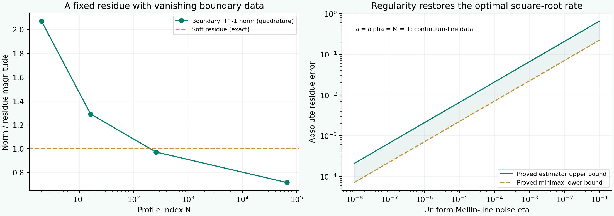

# Celestial Infrared Stability

**When do approximate celestial data determine an infrared soft coefficient?**

Deep Bhattacharjee · James Montgomery Lockwood · Tristan Romanov · Ikailo John Sessford · Ushashi Bhattacharya · Sanjeevan Singha Roy

Working research draft with one unranked prospective author list supplied by the project lead. Coauthor review and approval remain pending.

[Read the paper](mdpi-preprints/CelestialIRPaper.pdf) · [Reproduce the calculations](#reproduce) · [Sources and originality review](RELATED-WORK.md) · [Proof status and open targets](PROOF-STATUS.md)

## Gravitational memory, resummed data, and ordered limits

The current draft derives the conventional Bondi soft contribution for a smooth finite-flux news family. At fixed memory, increasing pulse duration drives the displaced Mellin data, radiated energy, and finite-window news signal to zero. The proof gives exact window errors and matching recovery exponents when the duration is unknown but the frequency derivative is uniformly bounded. [Bondi proof](mdpi-preprints/CelestialIRPaper.pdf)

A separate theorem recovers the amplitude of a prescribed resummed branch of exponent $\gamma$, with matching small-noise error order `M^(a/(a+alpha)) eta^(alpha/(a+alpha)) [log(M/eta)]^gamma`. The template parameters are known and the remainder obeys a global power bound. [Branch recovery proof](mdpi-preprints/CelestialIRPaper.pdf)

A double Mellin example gives two different ordered residues. A two-channel retarded-time calculation gives an exact inverse noise norm on the line with real Mellin weight $1/2$. The former concerns a scalar model and the latter concerns a change of transform representation. [Ordered limits](mdpi-preprints/CelestialIRPaper.pdf) · [Fourier–Mellin identity](mdpi-preprints/CelestialIRPaper.pdf)

For massive QED at leading order, we prove a sharp logarithmic rate for reconstructing signed angular charge data at one known speed. On the massless scalar principal series, we prove that a time translation can push arbitrarily close to the entire norm of a unit wave packet out of a fixed Mellin band. [Massive Ward kernel](mdpi-preprints/CelestialIRPaper.pdf) · [Mellin band leakage](mdpi-preprints/CelestialIRPaper.pdf)

The [research ledger](RESEARCH-ATTEMPTS.md) records the outcomes across eight topics, including recent results from the cited researchers and remaining physical questions.

## Angular soft data and logarithmic modes

The current revision connects the two research targets through a direct-data theorem. For angular coefficient fields in a specified Banach space, Gaussian Mellin averages followed by finite differences recover the highest fixed-order soft-log pole coefficient. The written proof gives matching upper and lower error exponents at each fixed log degree, under an explicit global remainder prior.

For a bounded angular test, the error inherits its dual norm. This includes `L2` pairings on an admissible angular patch and Sobolev pairings for angular distributions. An independently established physical charge map can transfer the bound to its soft contribution; the theorem does not establish that Ward identity or the hard contribution.

The improved no-log upper bound at `a = alpha = 1` is `2(e/pi)^(1/4) sqrt(M eta)`. For log degree `m >= 1`, an explicit cutoff-profile pair proves that the exponent `alpha/(a+alpha)` cannot be improved over the stated class. Constants depend on fixed `m` and are not claimed sharp.

The full principal part is also recoverable in this model. When a degree-`m` logarithmic expansion is unknown, the coefficient of `z^(-k-1)` has matching small-noise error order

`M^(a/(a+alpha)) eta^(alpha/(a+alpha)) [log(M/eta)]^(m-k)`.

This is a componentwise minimax statement at fixed degree and reference convention. In a degree-two expansion, the highest pole has no additional log loss; the double pole has one; the ordinary residue has two. The paper supplies explicit interpolation weights and both bounds.

[Full principal-part proof](mdpi-preprints/CelestialIRPaper.pdf) · [Written angular/logarithmic proofs](mdpi-preprints/CelestialIRPaper.pdf) · [Research context](RESEARCH-CONTEXT.md) · [Published problem map](OPEN-PROBLEMS.md)

## The foundational instability result

A soft residue can stay fixed while the entire Mellin transform on a vertical line becomes uniformly arbitrarily small. This occurs even for positive profiles with the same complex analyticity radius.

For fixed $R>0$, $c>0$, and $a>0$, take

$$A_N(\omega)=c\,\omega^{-p}(1+\omega/R)^{-N},\qquad N>a.$$

Then

$$\operatorname{Res}_{s=p}\widetilde A_N(s)=c,\qquad
\sup_{\nu\in\mathbb R}|\widetilde A_N(p+a+i\nu)|
=cR^a B(a,N-a)\longrightarrow0.$$

The revised paper adds two complementary results:

- **Leading-soft boundary instability.** On the contour through the pole, Abel boundary distributions tend to zero in `H^(-q)` for every `q > 1/2`, with an exact integral norm and a logarithmic decay law, while the residue stays fixed.
- **Direct recovery from noisy Mellin data.** Under an explicit global endpoint modulus of order `alpha`, a Gaussian estimator and a two-profile lower bound give the matching minimax exponent `alpha/(a+alpha)` on a displaced line. For `a = alpha = 1`, the error is of order `sqrt(M eta)`. A finite frequency-band bound states its additional tail prior.

These statements use different, explicitly specified data norms. Matching exponents do not imply matching optimal constants. Full written proofs appear in the paper; computational controls are reproducible below.

The original beta-family proof is explicit. The stripped profile is completely monotone, its nearest complex singularity stays at $-R$, and its derivative at zero grows like $N/R$. A uniform derivative or complex-norm bound would supply an additional restriction.

For a constant subleading soft term, choose $p=0$, $a=1$. The data line is then the usual four-dimensional principal series. For a leading $\omega^{-1}$ term, the theorem concerns a displaced line to the right of its pole. The new boundary theorem treats the leading pole separately in a negative Sobolev norm. It does not assign an ordinary uniform function norm to a contour containing a pole.

## What the package proves

| Result | Assumptions | Certificate |
| --- | --- | --- |
| Discontinuous soft-residue extraction | The stated scalar Mellin-kernel family, with a fixed vertical line strictly inside the convergence strip | Beta-integral formula and exact norm |
| Leading-soft boundary instability | Abel boundary distributions; frequency-variable `H^(-q)` with `q > 1/2` | Exact Fourier norm and logarithmic asymptotic |
| Optimal exponent for direct residue recovery | Displaced-line bounded noise; explicit endpoint modulus and weighted integrability | Gaussian estimator and a matching two-point lower exponent |
| Finite frequency-band error bound | Continuum-band data plus a known weighted integral bound | Explicit complementary-error-function tail |
| Angularly smeared coefficient recovery | Explicit angular Banach-space prior and dual test; bounded Mellin-line noise | Vector Gaussian estimator and dual-norm error bound |
| Direct recovery of a highest soft-log pole | Fixed degree; global power remainder prior; weighted Bochner integrability | Finite-difference estimator and a matching minimax lower exponent |
| Full logarithmic principal-part recovery | Same class, unknown lower coefficients, fixed reference convention; small-noise regime | Explicit interpolation and inverse Gaussian smoothing; matching componentwise logarithmic losses |
| Resummation scope controls | Two stated scalar infrared models | Exact shifted-pole and incomplete-gamma transforms; finite truncations do not preserve the singularities |
| Sharp recovery of the highest fixed-order soft-log coefficient | Energy-space observations of the stripped kernel, degree $m$ in logarithmic energy, width $T$, bounded deterministic noise $\delta$ | Optimal error $\delta\,m!\,2^{2m-1}/T^m$ for the highest Mellin pole coefficient |
| Covariance of higher-pole coefficients | An energy-independent local unit change and meromorphic Mellin continuation | Exact triangular transformation law |
| Reference-scale cancellation | The reference energy transforms with the chosen energy unit | The extra Mellin-weight factor cancels in the dimensionless convention |



[Original fixed-radius counterexample figure](assets/residue-instability.png)

## Research scope

The paper contains complete mathematical arguments for the stated classes. The beta integral, Gaussian regularization, two-point minimax method, Chebyshev extremality, Mellin soft-pole dictionary, and logarithmic multiplets have established antecedents. Completely monotone extrapolation also has close prior work, now cited. Originality of the combined formulation remains under review.

Recovery of a polynomial coefficient from a measured window needs the finite-degree model on that window. Identifying it with an actual infrared pole coefficient additionally requires the stated asymptotic tail bound. A remainder can vanish on the measured interval and grow farther into the infrared, changing the pole.

The rational profiles have positivity and analyticity properties explicitly proved in the paper. Establishing that a full unitary, crossing-symmetric scattering theory realizes this family is an additional physical problem. The logarithmic recovery theorem treats a fixed perturbative coefficient satisfying its global remainder assumption; log degree is not universally equal to loop order. Renormalization-group resummation can change multipoles into branch cuts.

The celestial motivation comes from Sabrina Pasterski's chapter and Perimeter's Celestial Holography Initiative. Benjamin Muntz's treatment of units motivates the convention check. The cited researchers and institutions provide source context. Their participation or endorsement is unconfirmed. [Primary sources](RELATED-WORK.md)

## Reproduce

Use Python 3.11+ and Julia 1.10+.

```sh
python -m pip install -r requirements.txt
python scripts/verify_recovery.py
python scripts/verify_direct_stability.py
python scripts/verify_angular_recovery.py
python scripts/verify_log_recovery.py
python scripts/verify_resummation.py
python scripts/verify_radiative_example.py
python scripts/verify_branch_recovery.py
python scripts/verify_ordered_limits.py
python scripts/verify_framework_bridge.py
python scripts/verify_massive_angular.py
python scripts/verify_mellin_translation.py
python scripts/verify_ward_controls.py
python scripts/verify_scale_jets.py
julia --startup-file=no julia/verify_exact.jl
julia --startup-file=no julia/verify_log_jet.jl
julia --startup-file=no julia/verify_finite_identities.jl
julia --startup-file=no julia/verify_sampling.jl
julia --startup-file=no julia/verify_exponent.jl
julia --startup-file=no julia/verify_projection.jl
julia --startup-file=no julia/verify_kinked_line.jl
python scripts/make_figure.py
python scripts/make_stability_figure.py
lean lean/ScaleJets.lean
lean lean/CelestialIR.lean
```

The manuscript TeX source is in `mdpi-preprints/MDPICelestialIRTeX.zip` (pdflatex, compile twice).

The written proofs establish the infinite statements. The scripts replay exact finite identities and high-precision controls, with their scope recorded in `reports/`. The independent standard-library Julia replay checks the full interpolation and inverse-smoothing algebra with arbitrary-precision rational arithmetic; CI preserves the generated verification records.

Lean 4.34.1 checks the symbolic integer double-pole group law, inverse, reference-scale cancellation, and an explicit counterexample to ordinary residue invariance. Its module imports `Std`. `lean/CelestialIR.lean` (also `Std` only, no `sorry`, 61 audited theorems) adds the general pole-jet shear for jets of every length, the forward-difference identity for every degree, the Bondi harmonic norm identity and its $H^2$ domination, the two expansions behind the ordered-limit residues, the discrete simplex gap identity, and the Chebyshev leading coefficient for every degree with exact weights up to degree four. The new Julia scripts check the discrete-sampling bounds, the unknown-exponent estimator and its lower-bound pairs, the contact-term projection lemma and the kinked-line model, and replay the finite identities in exact rational arithmetic. The analytical Mellin, distributional boundary, and minimax results have written proofs in the manuscript and are not Lean formalizations.

## Authors and review

All six prospective authors appear in the same byline category, without contribution rankings. Their names were transcribed from the existing Yang-Mills project's citation record. This draft assigns no unconfirmed affiliation, contribution, approval, or signature. The author list and scientific text require coauthor review before external submission.

An AI coding assistant assisted the derivation, literature search, implementation, and drafting. Human authors are responsible for reviewing any publication they approve.
